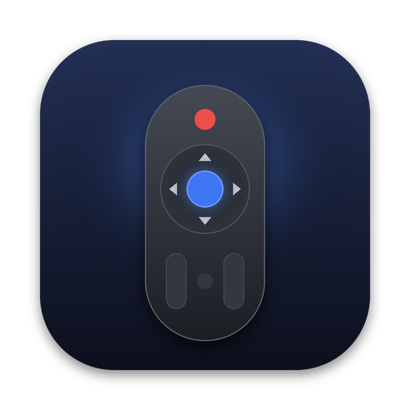

# Samsung Remote

Controle remoto nativo de macOS para TVs Samsung Tizen, no menu bar, pela rede local.

<p align="center"></p>

- D-pad, volume e canal com repetição, mídia, Home, Voltar, Fonte
- Pareamento com a TV uma vez só (token no Keychain)
- Liga a TV por Wake-on-LAN e desliga com um clique
- Atalhos de teclado (setas, ⏎, ⌫, +/−, M, H…)
- Sem cloud e sem dependências

TV de referência: **Samsung UN65AU8000GXZD** (2021). Deve funcionar em TVs Samsung Tizen de 2018 em diante.

## Rodando

Requisitos: macOS 14+ e Xcode 16+.

```bash
scripts/dev.sh open   # abre no Xcode → ⌘R
# ou
scripts/dev.sh run
```

Na primeira vez: clique no ícone de controle no menu bar, digite o IP da TV e aceite o pedido na tela da TV.
Para ligar a TV pela rede, ative **Configurações › Geral › Rede › Configurações avançadas › Ligar com dispositivo móvel**.

## Desenvolvimento

Este repositório é feito para trabalhar com agentes de código. Comece por [`AGENTS.md`](AGENTS.md).
Specs em [`docs/specs/`](docs/specs/), protocolo da TV em [`docs/protocol/`](docs/protocol/samsung-tizen-remote.md).

```bash
scripts/dev.sh test                  # testes unitários
scripts/dev.sh tv-info 192.168.0.50  # diagnóstico da TV
```
